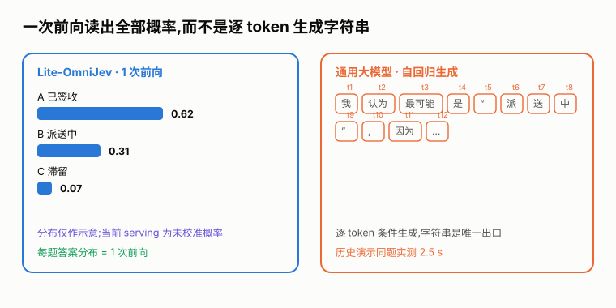
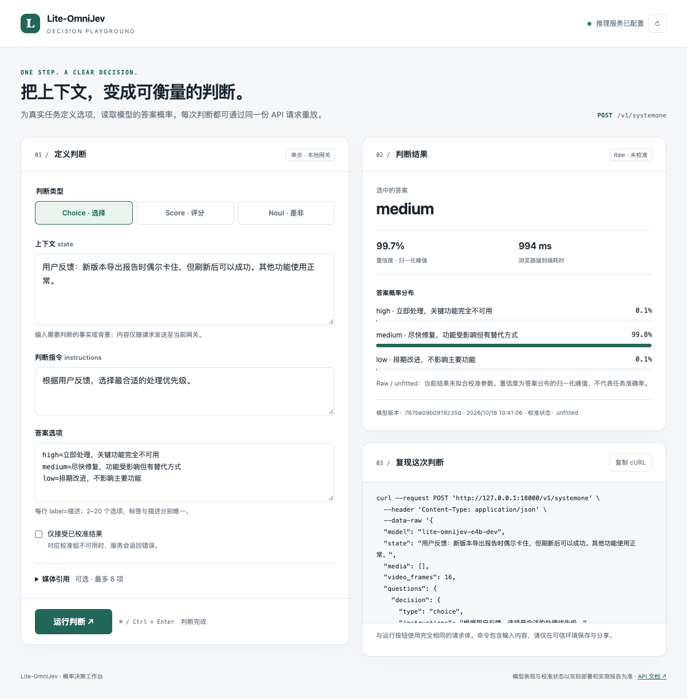
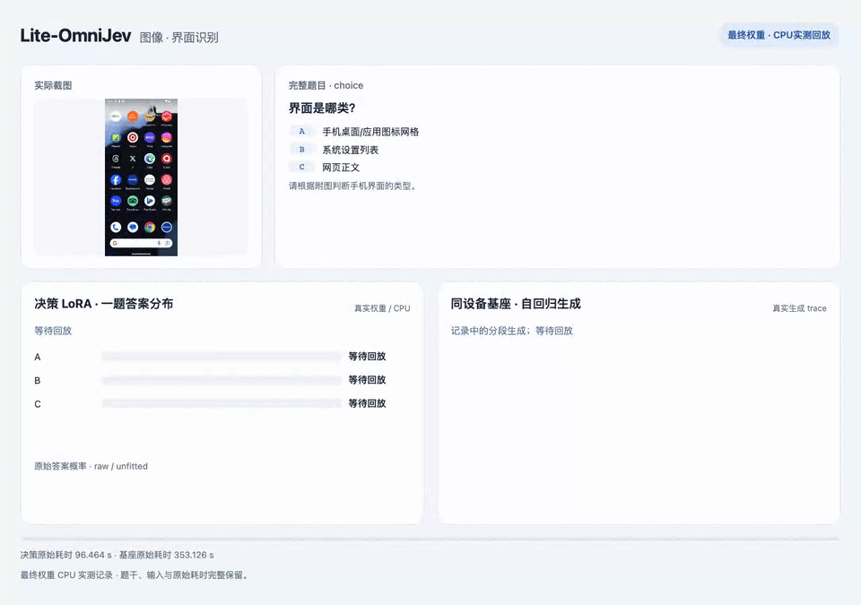
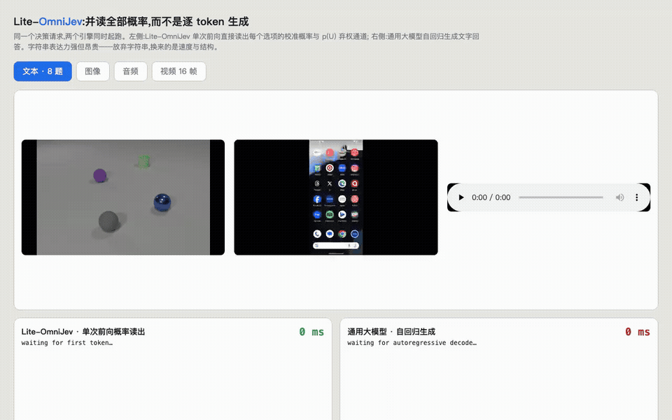
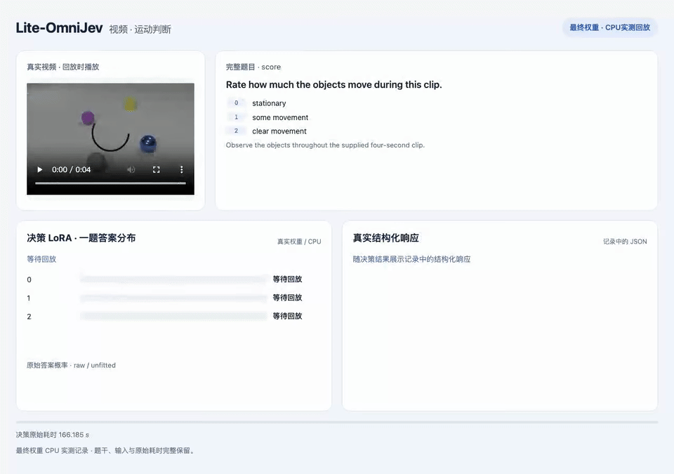
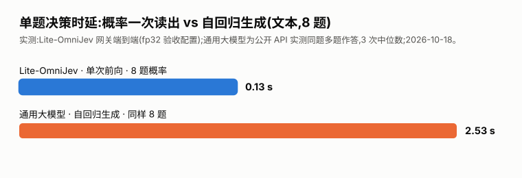
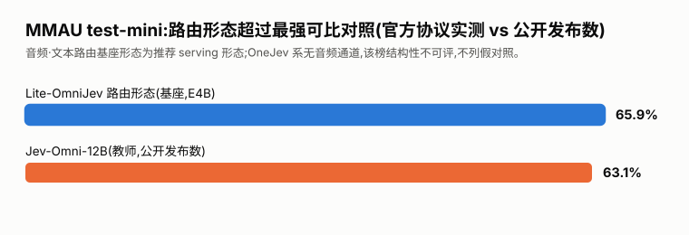
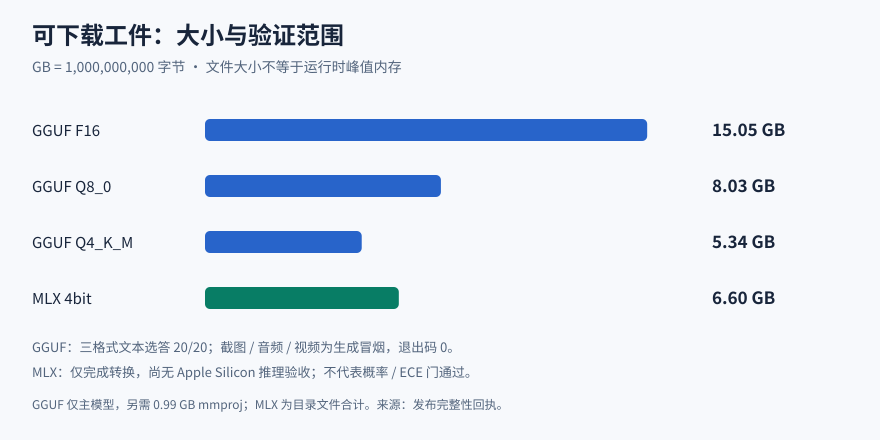

# Lite-OmniJev

<div align="center">
  
</div>

**决策不该逐 token 生成。** Lite-OmniJev 是一个单步多模态决策模型:冻结 Gemma-4 E4B 基座 +
决策 LoRA,每题一次前向**同时读出**所有选项的概率与置信度。
当前 vLLM 发布配方返回原始概率(`calibration: unfitted`);校准证据绑定另一个运行配方。
Choice(2–20 项)/ Score(2–10 级)/ yes-no,文本·图像·截图·音频·视频五模态。
使用官方模板与完整答案 token 读出,直接返回结构化判断。每题仍有一个后端生成 token 的计量。

**模型与权重(HF):[Chinzhu/Lite-OmniJev](https://huggingface.co/Chinzhu/Lite-OmniJev)**
——fp32 合并权重(分片)、LoRA adapter、GGUF F16/Q8_0/Q4_K_M、MLX 4bit、全套 serving 验证回执。

## 工作台



三类判断、受信媒体引用、原始概率、校准状态和可重放 cURL。启动方式见下方部署配方。

## 实录:并行概率读出 vs 自回归生成

两侧同时起跑:左 = Lite-OmniJev 每题一次前向读出答案概率;右 = 通用大模型自回归生成
同样的答案。文本场景 8 题并行请求,不是八题共用一次前向。实况录制,无剪辑加速。
以下为历史内部诊断录屏,含内部读出信息;当前产品界面不展示 U。

| 文本 · 8 题 | 图像 |
|---|---|
|  |  |
| **音频** | **视频 16 帧** |
|  |  |

*GIF 为实况录屏压缩版;完整 webm 见 [docs/demo/](docs/demo/),原始分辨率版本随 HF 仓库分发。*

**同题实测(文本 8 题)**:Lite-OmniJev 网关端到端 **0.13 s**,通用大模型自回归 **2.5 s**——
19 倍差距,而且右侧给一段文字,左侧给每一项的概率。

<div align="center">
  
</div>

历史演示配方的网关侧实测(Server-Timing,并发/缓存配置与默认验收配方不同;非 p95/SLO):

| 模态 | 前向(upstream) | 网关端到端 |
|---|---|---|
| 文本 · 8 题 | 119 ms | **128 ms** |
| 图像 | 343 ms | 454 ms |
| 音频 | 576 ms | 885 ms |
| 视频 16 帧 | 1152 ms | 2216 ms |

## 基准(同题同协议实测;对照引用其公开发布数)

| 榜 | 本模型(adapter 全模态挂载) | 基座 | 最强对照公开数 |
|---|---|---|---|
| JevBench 231 | **76.62%** | 76.19% | Jev-Omni-12B 86.15 |
| MMAU test-mini 1000 | 60.6%(挂载)/ **65.9%(音频·文本路由基座)** | 65.9% | Jev-Omni-12B 63.10 |
| MVBench 九任务 1800(参照) | **48.5%** | 47.2% | 教师 53.09(14 任务/2786,口径不同) |

<div align="center">
  
</div>

不利的数字也在表里(JevBench 距 12B 教师尚有差距——最终D3P蒸馏使用600题切片,不是全项目训练题量);MMAU 路由形态超过教师公开发布数,仅说明该评测路由方案的表现;当前发布启动脚本仍全模态挂载 adapter,不自动切换模型。

## 量化与运行时验证

<div align="center">
  
</div>

llama.cpp 三档在 20 个公开文本案例上与参考选答一致。截图/音频/视频为生成式冒烟通过,
尚未完成完整原始概率、量化 ECE 或真机验收;不能据此宣称全模态零退化。

| 档位 | 文本(20 案例选答一致) | 截图 | 音频 | 视频 |
|---|---|---|---|---|
| F16(15.05 GB) | **20/20** | ✓ | ✓ | ✓ |
| Q8_0(8.03 GB) | **20/20** | ✓ | ✓ | ✓ |
| Q4_K_M(**5.34 GB 文件**) | **20/20** | ✓ | ✓ | ✓ |

截图输入需按文档化预处理(RGBA→RGB,长边 ≤1344;参数随 `gateway/receipts/` 分发);
MLX 4bit(6.60 GB)已完成转换,Apple Silicon 运行测试仍待完成。
[实测边界与运行参数](docs/gguf-multimodal.md)。E2B 蒸馏包与真实设备验收尚未完成。

## 接入

**三种问题模式**(可任意组合,单次请求最多 32 题):

```jsonc
// Choice:2–20 个选项,字母由你定义
"q1": {"type": "choice", "instructions": "该订单今天最可能的状态?",
       "criteria": {"A": "已签收", "B": "派送中", "C": "滞留在站点"}}
// Score:2–10 级,每级给描述
"q2": {"type": "score", "instructions": "工单紧急程度打分",
       "criteria": ["1 很低", "2 偏低", "3 一般", "4 偏高", "5 很高"]}
// Noul:是/否判断
"q3": {"type": "noul", "instructions": "现有信息是否足以判定已签收?"}
```

**五种模态**(`media` 数组随请求携带,引用受信媒体根内的文件;视频默认抽 16 帧,可指定 8):

```jsonc
"media": [{"type": "image", "uri": "screenshot.png", "sha256": "<文件的 sha256>"}]   // 图像/截图
"media": [{"type": "audio", "uri": "meeting.wav",   "sha256": "<sha256>"}]          // 音频(≤30s)
"media": [{"type": "video", "uri": "clip.mp4",      "sha256": "<sha256>"}], "video_frames": 16  // 视频(≤60s)
// 不传 media 即纯文本决策
```

**一次调用**:

```bash
curl -s http://127.0.0.1:8000/v1/systemone -H 'Content-Type: application/json' -d '{
  "state": "用户订单在配送第 3 天,物流显示已到末端站点。",
  "questions": {
    "q1": {"type": "choice", "instructions": "该订单今天最可能的状态?",
           "criteria": {"A": "已签收", "B": "派送中", "C": "滞留"}},
    "q2": {"type": "noul",   "instructions": "现有信息是否足以判定?"}
  }
}'
```

返回每题的概率分布、`choice`/`score`/`noul` 判定与置信度。Score 返回从 0 开始的期望等级。**四条部署路径**(详见 HF
模型卡"快速开始"):transformers + LoRA adapter(小体积)/ vLLM + 分片权重(推荐 serving,
脚本随包)/ llama.cpp GGUF(Mac/端侧,Q4_K_M 5.34 GB)/ MLX 4bit。网关启动脚本与
100 案例逐位 parity 回执在 HF 仓库 `gateway/`。

## 工程可信度

已测发布配方的数值证据:vLLM 0.26 serving 两遍**精确可重复**,对 float32 HF 参考最大
偏差 **5.75e-6**(预算 1e-3);网关与该报告**逐位一致**;真实浏览器(Chromium → 网关 →
实际权重)契约验证通过;完整产品验收仍按终局票逐项收口。回执随 HF 仓库分发,可独立复核。

## 下载与接入

GitHub 用于展示 README、演示与图表。模型、量化文件、运行必需代码、依赖锁和部署说明统一在
[HF 模型仓库](https://huggingface.co/Chinzhu/Lite-OmniJev)。
按照模型卡“快速开始”安装随包 runtime wheel 并启动网关，然后打开 `http://127.0.0.1:8000/`。
媒体使用服务器受信路径与 SHA256 引用。当前发布配方为原始概率，完整端侧/生产验收边界见 HF 模型卡。

## 许可

项目新增材料与权重以 **CC-BY-NC-SA-4.0** 提供（非商业）；基座和第三方依赖保留各自许可。
Decision Index 因上游数据不可得尚未完成，本项目不宣称 SOTA。
