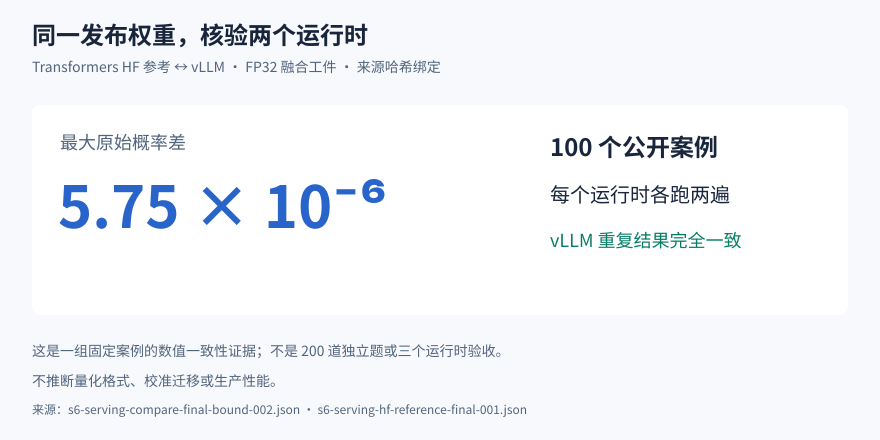

# Lite-OmniJev

**多模态输入 → 明确选项 → 概率判断。**
冻结 Gemma 4 E4B 基座，训练决策 LoRA；每题一次前向直接取得全部选项的概率，
返回 Choice、Score 或 yes/no 结果，适合日历调度、工单分流、界面识别、声音与视频判断。
支持文本、图像、截图、音频和视频。

[模型下载与安装](https://huggingface.co/Chinzhu/Lite-OmniJev#快速开始) ·
[训练故事](https://huggingface.co/Chinzhu/Lite-OmniJev/blob/main/TRAINING.md) ·
[性能与回执](https://huggingface.co/Chinzhu/Lite-OmniJev/blob/main/PERFORMANCE.md) ·
[文件大小与格式选择](https://huggingface.co/Chinzhu/Lite-OmniJev/blob/main/FILES.md)


## 看实际输入和输出


工作台支持三类判断、五种模态、原始概率、校准状态与可重放cURL。
下面是最终权重的真实CPU实测回放：每场景一题，完整题干和选项一直可见；
文本/图像包含同输入基座的真实自回归输出。原始耗时保留，长等待已压缩并在画面标注。
WebM音频段带真实输入音轨；GIF为静音预览。

| 文本：日历操作 | 图像：界面判断 |
|---|---|
|  |  |
| **音频：环境录音** | **视频：运动判断** |
|  |  |

完整录屏：[文本](docs/demo/demo-text.webm) · [图像](docs/demo/demo-image.webm) ·
[音频（有声）](docs/demo/demo-audio.webm) · [视频](docs/demo/demo-video.webm)。

## GPU服务实测

H20、FP32、vLLM 0.26.0、eager、禁前缀缓存、单活跃序列。
每个请求含Choice / Score / Noul三题，逐题执行；下表为服务端`Server-Timing`。


| 输入 | Upstream | 网关总耗时 |
|---|---:|---:|
| 文本 | 392 ms | 973 ms |
| 图像 | 1,111 ms | 1,815 ms |
| 截图 | 716 ms | 3,606 ms |
| 音频 | 1,321 ms | 2,417 ms |
| 视频8帧 | 1,256 ms | 3,294 ms |
| 视频16帧 | 1,713 ms | 3,543 ms |

计时包含服务内预处理、排队与推理；网络往返在此计时之外。
CPU回放和这张GPU服务表采用不同设备与任务，原始证据见[性能报告](https://huggingface.co/Chinzhu/Lite-OmniJev/blob/main/PERFORMANCE.md)。

## 公开榜单

| 协议 | 决策adapter | 基座 | 对照公开数 |
|---|---:|---:|---|
| JevBench231 | 76.62% | 76.19% | Jev-Omni-12B 86.15% |
| MMAU test-mini1000 | 60.6% | 65.9% | Jev-Omni-12B 63.10% |
| MVBench九任务1800 | 48.5% | 47.2% | 教师53.09%（14任务/2786，协议范围不同） |


我方两种形态均为官方协议实测，对照列引用其公开发布数；MVBench对照范围单独标注。
[评测说明与回执](https://huggingface.co/Chinzhu/Lite-OmniJev/blob/main/EVALUATIONS.md)。

## 格式选择


| 格式 | 下载体积 | 用途 |
|---|---:|---|
| FP32五分片 | 31.98GB | Linux GPU API与Playground |
| 决策LoRA | 139.60MB | 配合固定基座做PEFT集成 |
| GGUF F16 / Q8_0 / Q4_K_M | 15.05 / 8.03 / 5.34GB | llama.cpp，另配0.99GB mmproj |
| MLX 4bit | 6.60GB | Apple Silicon生态转换工件 |

GB为十进制文件体积，显存与运行内存另计。
GGUF三档在20个公开文本案例上与参考选答20/20一致；截图、音频、视频生成探针全部成功。
截图使用RGB、长边≤1344；命令与固定运行时见[GGUF使用说明](docs/gguf-multimodal.md)。

## 开始使用

按[HF快速开始](https://huggingface.co/Chinzhu/Lite-OmniJev#快速开始)下载完整包、校验SHA256、
安装随包runtime和冻结服务依赖，启动模型后端与网关；打开本地工作台`http://127.0.0.1:8000/`。
HF包含运行必需代码、tokenizer、processor、官方模板和启动脚本。

```bash
curl http://127.0.0.1:8000/v1/systemone \
  -H 'Content-Type: application/json' \
  -d '{
  "state": "用户反馈：新版本导出报告时偶尔卡住，但刷新后可以成功。其他功能使用正常。",
  "questions": {
    "decision": {
      "type": "choice",
      "instructions": "根据用户反馈，选择最合适的处理优先级。",
      "criteria": {
        "high": "立即处理，关键功能完全不可用",
        "medium": "尽快修复，功能受影响但有替代方式",
        "low": "排期改进，不影响主要功能"
      }
    }
  }
}'
```

同题实际返回节选：

```json
{
  "model": "767be09b0919235d",
  "answers": {
    "decision": {
      "type": "choice",
      "choice": "medium",
      "probabilities": {
        "high": 0.0005386023780616775,
        "medium": 0.9980832657757281,
        "low": 0.001378131846210102
      },
      "confidence": 0.9971248986635922,
      "calibration": "unfitted",
      "confidence_semantics": "normalized_peak"
    }
  }
}
```

Choice接受2–20个选项；Score接受2–10个有描述的等级，返回从0开始的期望等级；
Noul返回yes概率。媒体使用服务端受信文件URI和SHA256引用；部署配方使用原始答案概率。



## 许可

新增代码、材料与权重按[CC-BY-NC-SA-4.0](LICENSE)提供；基座及第三方组件保留各自许可，归属与许可文本见[NOTICE.md](NOTICE.md)。
GitHub承载产品展示，完整模型、部署材料与验证回执统一在[HF模型仓库](https://huggingface.co/Chinzhu/Lite-OmniJev)。
